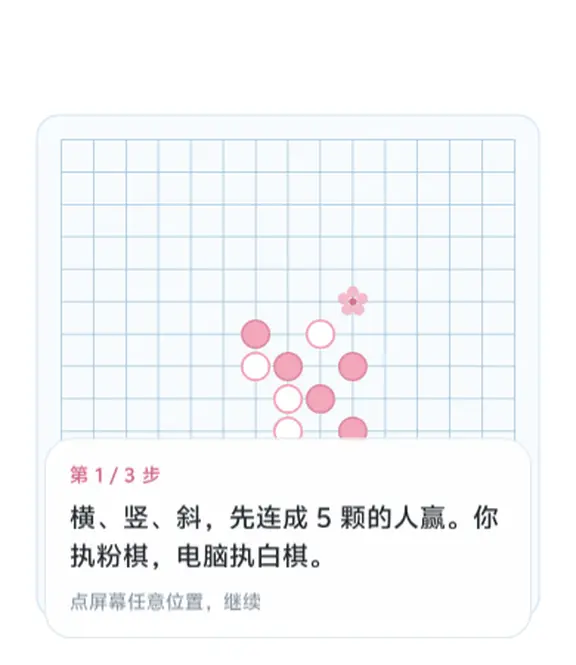
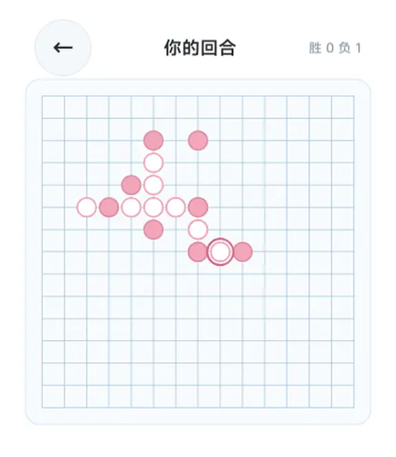
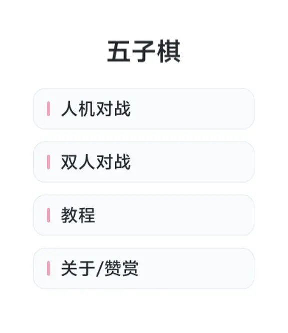

# BlueOS-Watch
My watch faces and apps developed with BlueOS Studio.
# 五子棋 (Gomoku for vivo WATCH GT)

一款专为 **vivo WATCH GT** 量身定制的智能手表五子棋应用。

## ✨ 功能特点
* **人机对战**：与电脑 AI 进行智力博弈。
* **双人对战**：与身边的朋友在同一设备上轮流落子。
* **新手教程**：内置图文并茂的教学引导，轻松上手。
* **顺滑交互**：支持点击屏幕落子，**旋转表冠缩放棋盘，拖动屏幕移动棋盘**，完美适配手表小屏幕操作。

## 📱 界面预览

## 🛠️ 开发技术栈
* **开发环境**：BlueOS Studio
* **辅助工具**：DeepSeek (AI 辅助代码编写与逻辑梳理)
* **核心机制**：五子棋胜负判定算法 (横、竖、斜五子连珠)、AI 决策逻辑。
* **交互特性**：基于表冠旋转事件的棋盘缩放算法，以及触摸屏手势拖拽移动。

## 👨‍💻 开发者信息
* 开发者：@hui1105
* 反馈邮箱：hui11052026@163.com
